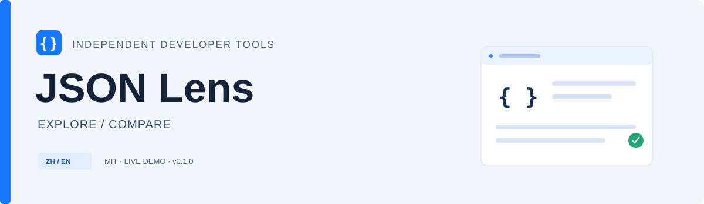
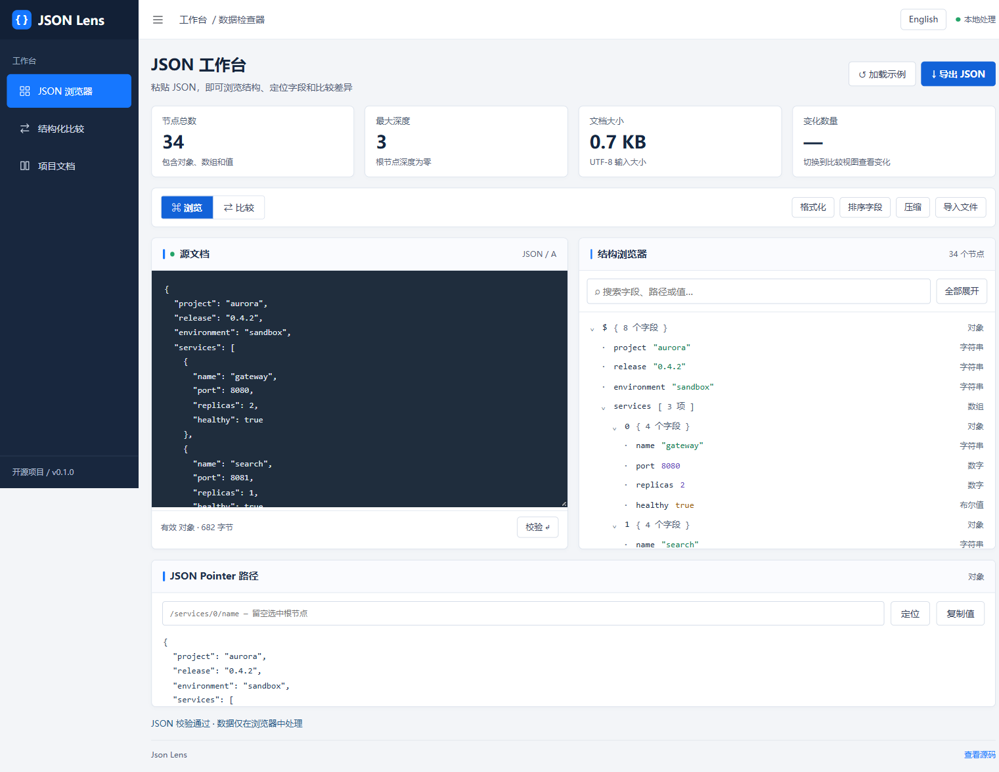

[](https://github.com/honggege957-collab/json-lens/actions/workflows/ci.yml)  

# JSON Lens

A browser workbench for understanding JSON, one key at a time.

一个在浏览器中运行的 JSON 数据工作台：看清结构，定位路径，比较变化。

**[Live demo](https://honggege957-collab.github.io/json-lens/)** · **[中文说明](README.zh-CN.md)** · [Contributing](CONTRIBUTING.md) · [Changelog](CHANGELOG.md)



## What it does

| Capability            | Behavior                                                                                          |
| --------------------- | ------------------------------------------------------------------------------------------------- |
| **Tree explorer**     | Expand and collapse objects, search keys / paths / scalar values, and inspect a selected node.    |
| **JSON Pointer**      | Resolve RFC 6901 pointers, including escaped slashes, tildes and empty keys.                      |
| **Structural diff**   | See added, removed and changed values. Object key order is ignored; arrays are compared by index. |
| **Useful transforms** | Pretty-print, minify, sort object keys, import a local file and export JSON or a diff report.     |
| **Local processing**  | No account, analytics or data upload. Chinese / English UI with a remembered language preference. |

## Run locally

Requires **Node.js 22+**. No external packages are required to run the app.

```bash
git clone https://github.com/honggege957-collab/json-lens.git
cd json-lens
npm ci
npm start
```

Open **http://127.0.0.1:4173**. Use `PORT=4174 npm start` on macOS/Linux or `$env:PORT=4174; npm start` in PowerShell to choose another port. ES modules require a local HTTP server; opening `index.html` directly is not supported.

Use the **English / 中文** button in the upper-right corner. Chinese is the initial language; a browser preference is saved locally. User-entered data and task IDs are preserved when the language changes.

## Try this

Load the sample, switch to **Compare**, and inspect the eight changes. Return to Explorer and resolve `/services/0/name` to see `"gateway"`.

## How it works

`src/json.js` contains parsing, traversal, pointer resolution and comparison. `app.js` renders the UI using text nodes, keeping pasted values out of HTML markup. `src/i18n.js` handles static and dynamic translations.

```text
src/       Core logic and locale support
test/      Node.js regression tests
examples/  Synthetic data or runnable usage examples
assets/    Original SVG artwork and actual app screenshot
scripts/   Local server and static-site builder
```

## Verification

```bash
npm test
npm run build
```

The test suite contains **13 tests**. GitHub Actions runs tests and builds on Windows and Ubuntu with Node.js 22 and 24. Browser checks cover the main interactions, language switching and layout at 390 px width. `npm run build` writes a static site to `dist/`; the demo workflow deploys it to GitHub Pages.

## Deliberate limits

Inputs are capped at 2 MiB and 160 nesting levels. The explorer renders up to 1,500 matching nodes; diff results cap at 2,000 changes and include a `truncated` flag. Diff reports are an inspection format, **not RFC 6902 JSON Patch**. Numbers follow standard JavaScript JSON parsing, so very large integers may lose precision. There is no schema validator or persistence of pasted documents.

## Project scope

An independent personal project created with AI-assisted development. Source code and example data were created for this repository; examples are synthetic. This is a small working release intended to be read, run and extended.

## License

[MIT](LICENSE)
